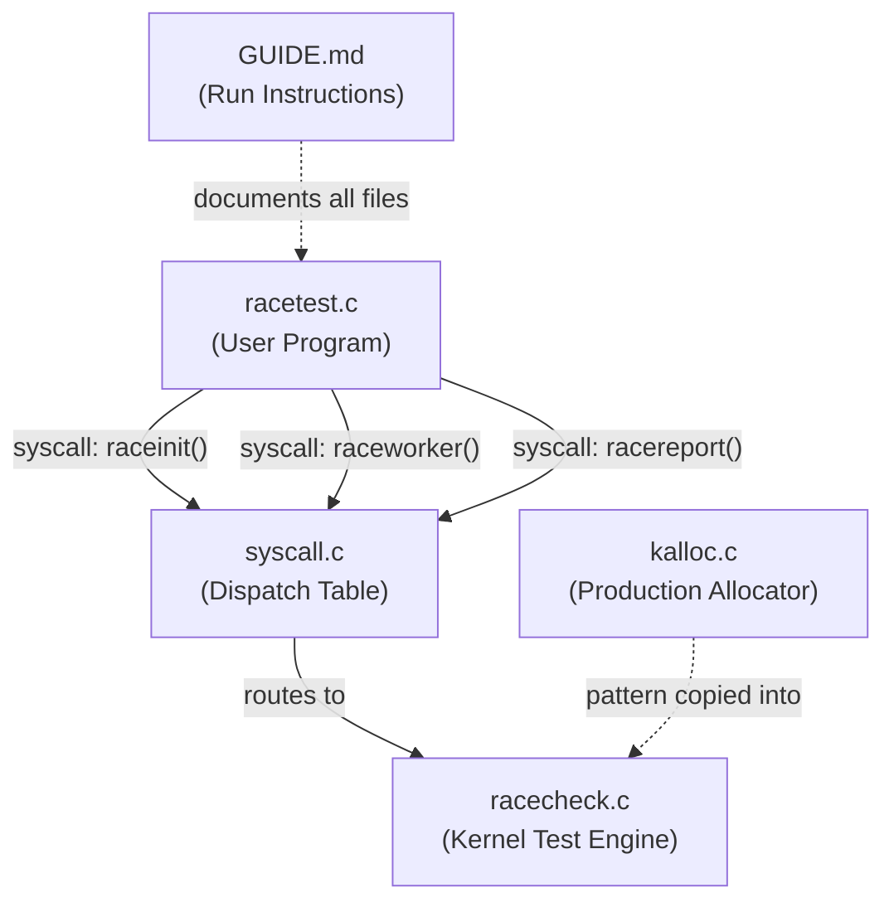

# Case Study 14 — File-by-File Explanation

## How the 5 Open Files Work Together



---

## 1. [`kalloc.c`](file:///c:/Users/HP/Documents/OS%20record/OS%20CASE%20STUDY/case_study_14_rebuild/xv6-riscv/kernel/kalloc.c) — The Real-World Problem

**Role:** Shows the *production* shared data structure that motivates the entire case study.

### Key shared data (lines 21-24)

```c
struct {
  struct spinlock lock;      // ← the lock that prevents races
  struct run *freelist;      // ← the shared linked list (head pointer)
} kmem;
```

### The critical section you're studying (lines 73-77)

```c
acquire(&kmem.lock);         // ENTER critical section
r = kmem.freelist;           // Step 1: READ the head
if (r)
  kmem.freelist = r->next;   // Step 2: UPDATE the head
release(&kmem.lock);         // EXIT critical section
```

> [!IMPORTANT]
> **This is the heart of the case study.** The two steps (read head → update head) MUST be atomic. If two CPUs both execute Step 1 before either does Step 2, they both get the **same page** — a race condition causing duplicate ownership.

`kalloc.c` also shows the same pattern in [`kfree()`](file:///c:/Users/HP/Documents/OS%20record/OS%20CASE%20STUDY/case_study_14_rebuild/xv6-riscv/kernel/kalloc.c#L47-L63) (lines 59-62), where a freed page is pushed onto the list under the same lock.

---

## 2. [`racecheck.c`](file:///c:/Users/HP/Documents/OS%20record/OS%20CASE%20STUDY/case_study_14_rebuild/xv6-riscv/kernel/racecheck.c) — The Demonstration Engine (⭐ Core File)

**Role:** Implements the **actual experiment** your sir wants — first showing the inconsistency, then showing how synchronization fixes it.

### What it builds (lines 19-33)

A miniature copy of `kalloc.c`'s free list with 3 pages (`P0 → P1 → P2`):

```c
struct race_run {
  int id;                    // 0, 1, or 2
  struct race_run *next;
};

static struct {
  struct spinlock lock;      // xv6's real spinlock
  struct race_run pages[3];  // the 3 test pages
  struct race_run *freelist; // shared head pointer (like kmem.freelist)
  // ... per-worker tracking fields
} demo;
```

### 🔴 UNLOCKED path — Demonstrates the INCONSISTENCY (lines 115-124)

```c
// Both workers execute this simultaneously on different CPUs:
page = __atomic_load_n(&demo.freelist, __ATOMIC_RELAXED);  // Both read P0
next = page ? page->next : 0;                               // Both save P1

rendezvous(worker_id);  // ← wait until BOTH have read (forces the race)

if (page)
  __atomic_store_n(&demo.freelist, next, __ATOMIC_RELAXED); // Both write P1
```

**Result:** Both CPUs return `P0`. The head becomes `P1`. But `P0` is now "owned" by two processes — **data inconsistency!**

### 🟢 SPINLOCK path — Demonstrates the FIX (lines 126-133)

```c
rendezvous(worker_id);           // Both CPUs are ready
acquire(&demo.lock);             // ← Only ONE can enter
page = __atomic_load_n(&demo.freelist, __ATOMIC_RELAXED);
if (page)
  __atomic_store_n(&demo.freelist, page->next, __ATOMIC_RELAXED);
release(&demo.lock);             // ← Now the other can enter
```

**Result:** First CPU gets `P0`, second CPU gets `P1`. Head becomes `P2`. Every page owned by exactly one entity — **consistent!**

### The Audit (lines 141-183)

The [`audit_state()`](file:///c:/Users/HP/Documents/OS%20record/OS%20CASE%20STUDY/case_study_14_rebuild/xv6-riscv/kernel/racecheck.c#L141-L183) function counts how many times each page ID appears. If every page appears **exactly once** across allocations + remaining free list → CONSISTENT. Otherwise → INCONSISTENT.

---

## 3. [`racetest.c`](file:///c:/Users/HP/Documents/OS%20record/OS%20CASE%20STUDY/case_study_14_rebuild/xv6-riscv/user/racetest.c) — The User-Space Driver

**Role:** The xv6 program the student types at the shell prompt. It orchestrates the experiment.

### Flow (lines 42-58)

```
main()
 ├── run_case(UNLOCKED)     ← run without lock, expect INCONSISTENT
 │   ├── raceinit(0)        ← reset the test list to P0→P1→P2
 │   ├── fork() × 2         ← create 2 child processes (one per CPU)
 │   │   └── raceworker(id) ← each child enters the kernel test
 │   ├── wait() × 2         ← parent waits for both children
 │   └── racereport()       ← print audit results
 │
 ├── run_case(SPINLOCK)     ← run with lock, expect CONSISTENT
 │   └── (same steps)
 │
 └── Print PASS/FAIL
```

> [!NOTE]
> The `fork()` is critical — it creates **two separate xv6 processes** that get scheduled on **two different QEMU harts (CPUs)**. This is real concurrency, not simulated.

---

## 4. [`syscall.c`](file:///c:/Users/HP/Documents/OS%20record/OS%20CASE%20STUDY/case_study_14_rebuild/xv6-riscv/kernel/syscall.c) — The Wiring

**Role:** Connects user-space calls to kernel-space functions.

### What was added (lines 106-108, 136-138)

```c
// Function declarations
extern uint64 sys_raceinit(void);
extern uint64 sys_raceworker(void);
extern uint64 sys_racereport(void);

// Dispatch table entries
[SYS_raceinit]   = sys_raceinit,
[SYS_raceworker] = sys_raceworker,
[SYS_racereport] = sys_racereport,
```

When `racetest.c` calls `raceinit()`, the CPU traps into the kernel, `syscall()` looks up the number in this table, and dispatches to `sys_raceinit()` in `racecheck.c`.

---

## 5. [`GUIDE_Run_and_Explain_Case_Study_14.md`](file:///c:/Users/HP/Documents/OS%20record/OS%20CASE%20STUDY/case_study_14_rebuild/GUIDE_Run_and_Explain_Case_Study_14.md) — The Instructions

**Role:** Step-by-step guide to build and run everything in WSL + QEMU.

| Section | What it covers |
|---------|---------------|
| §1 | Start WSL Ubuntu, install toolchain |
| §2 | `make clean && make qemu CPUS=2` |
| §3 | Type `racetest` at xv6 shell |
| §4 | Expected output with INCONSISTENT → CONSISTENT |
| §5 | Code walkthrough snippets |
| §6 | How to present in PPT/report |

---

## How This Maps to Your Sir's Requirements

| Requirement | File(s) | What to show |
|------------|---------|-------------|
| **Identify shared data structure** | `kalloc.c` lines 17-24 | `kmem.freelist` — the physical-page free list |
| **Demonstrate inconsistency (no lock)** | `racecheck.c` lines 115-124 | Both CPUs get `P0` → INCONSISTENT |
| **Demonstrate synchronization fix (1 method)** | `racecheck.c` lines 126-133 | xv6 spinlock → each CPU gets a different page → CONSISTENT |
| **C code implementation** | `racecheck.c` + `racetest.c` | The full kernel module + user program |
| **Running the code** | `GUIDE.md` §2-§3 | Build in WSL, boot QEMU, type `racetest` |
| **Expected output** | `GUIDE.md` §4 | UNLOCKED=INCONSISTENT, SPINLOCK=CONSISTENT, PASS |

---

## The Race Condition Visualized

````carousel
### 🔴 Without Lock (INCONSISTENT)

```
Time ──────────────────────────────►

CPU 0                    CPU 1
─────                    ─────
READ head → P0           READ head → P0      ← both see P0!
SAVE next → P1           SAVE next → P1
   ┌── rendezvous ──┐
WRITE head = P1          WRITE head = P1      ← both write P1
RETURN P0 ✓              RETURN P0 ✗ DUPLICATE!

Free list: P1 → P2
P0 owned by BOTH → 💥 DATA CORRUPTION
```
<!-- slide -->
### 🟢 With Spinlock (CONSISTENT)

```
Time ──────────────────────────────►

CPU 0                    CPU 1
─────                    ─────
   ┌── rendezvous ──┐
acquire(lock) ✓          acquire(lock) 🔒 BLOCKED
READ head → P0               │
WRITE head = P1               │ spinning...
release(lock)                 │
                         acquire(lock) ✓
                         READ head → P1
                         WRITE head = P2
                         release(lock)
RETURN P0 ✓              RETURN P1 ✓

Free list: P2
Every page owned ONCE → ✅ CONSISTENT
```
````
